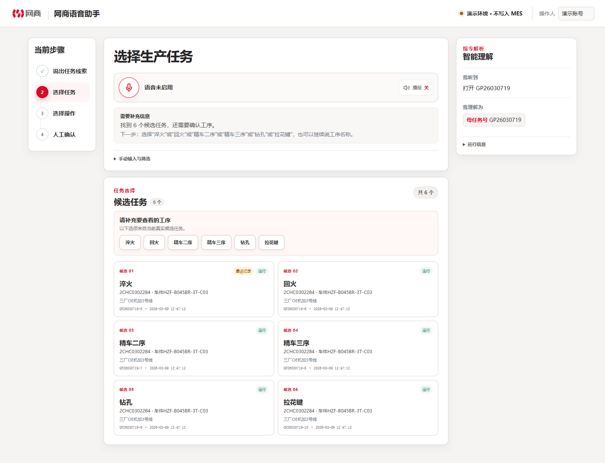
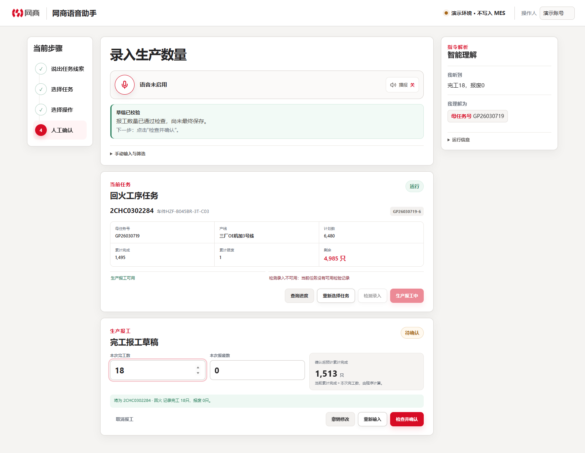
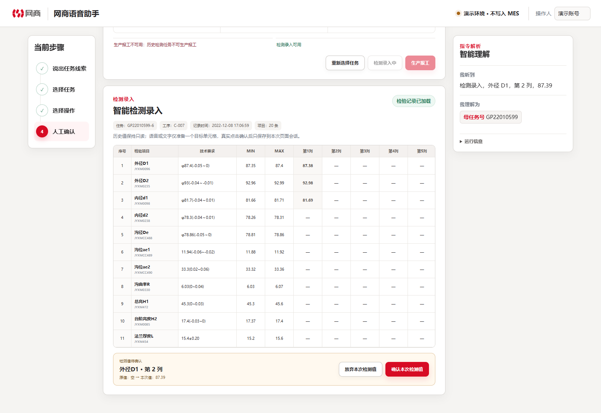

# 兆丰语音操作助手及智能检测录入

面向制造业生产现场的语音交互产品原型，围绕生产任务串联查询、进度查看、生产报工与检验数据录入，让操作人员能够用自然语言表达意图，在明确的任务上下文中核对并完成操作。

## 业务背景

生产报工与检验录入都需要准确关联任务、工序和数据字段。同一母任务可能包含多道工序，一次检测又涉及多个检验项目和测量列。简化输入的同时，仍需让操作人员清楚地知道当前处理的对象、即将记录的内容，以及哪些动作需要本人确认。

项目以语音为主要交互入口，保留文字输入和手动操作作为补充，将任务查找、候选澄清、数据校验与人工确认组织为连续的业务流程。

## 我的工作

- **确定任务与操作的约束**：以具体工序任务作为操作对象，区分可报工的运行任务与已关联检验记录的任务，统一查询候选、操作按钮和切换时的资格判断。
- **定义指令的输入输出**：将任务线索映射为候选条件，将检测输入拆为项目、测量列和数值；多条记录需要选择，信息不完整时不生成待确认值。
- **设计确认与恢复机制**：报工先生成草稿并校验数量，检测先定位目标单元格；最终保存由用户点击确认。切换任务前保护未确认内容，失败后保留可继续操作的上下文。
- **推进原型与验收**：借助 AI 辅助编码串联语音与文字入口、任务选择、报工及检测流程，将操作资格、组合指令、纠错与草稿保护写成验收用例。

## 核心体验

### 从任务线索定位到具体工序

用户可以输入任务号、产品或工序等线索。多个工序同时匹配时，助手展示候选并引导补充信息，帮助用户确认具体操作对象。



### 沿用任务上下文，完成报工复核

选定任务后，输入“完工18，报废0”即可形成结构化草稿，并预览确认后的累计完成数。数量通过校验后，用户仍需核对任务与数量，再进行最终确认。



### 将检测指令定位到目标单元格

“外径 D1，第 2 列，87.39”对应明确的检验项目、测量列和数值。界面同时呈现技术要求、上下限和历史记录，新增测量值经人工确认后保存，历史值保持只读。



## 关键迭代：共享任务入口，同时约束当前可执行的操作

| 环节 | 具体判断 |
|---|---|
| 发现的问题 | 报工与检测共用任务入口，仅切换页面不足以保证任务、候选、按钮和实际操作保持一致 |
| 判断依据 | 核查发现两类任务资格不同：没有检验记录的生产任务不能进入检测；历史检验样例也不能直接新建生产报工。未确认内容还需要在切换时保护 |
| 我的选择 | 将统一任务资格用于候选与操作校验；任务适配时复用，不适配时阻止当前对象执行，必要时转到合格任务选择。涉及未确认内容时，先由用户决定是否放弃 |
| 验证结果 | 已有用例覆盖资格不符的切换拦截、原任务及草稿保留、多检验记录选择，以及待确认检测值不被新查询覆盖 |

具体规则见[任务资格与操作切换用例](src/domain/workflow.test.ts#L406)；从项目、列到测量值的输入约束见[检测解析用例](src/domain/inspection.test.ts#L38)。

## 验证与评价

以下验证使用受控任务与转写文本，关注输入之后的业务流程：

| 评价问题 | 已有结果与证据 |
|---|---|
| 指令能否定位到明确的检测目标 | “外径 D1，第 2 列，87.39”形成对应待确认值；缺少信息、项目不匹配或列超出范围时不生成录入目标。见[解析用例](src/domain/inspection.test.ts#L38) |
| 人工确认是否是保存的必要步骤 | 页面用例验证确认前仅存在草稿，点击确认后第 2 列保存为 87.39；历史值与本次新增值分开处理。见[页面交互用例](src/App.test.tsx#L667) |
| 操作切换是否保留正确上下文 | 存在未确认内容且目标操作不适配当前任务时，拒绝切换并保留原任务、原操作与草稿；允许放弃时先清理草稿，再执行原切换意图。见[工作流用例](src/domain/workflow.test.ts#L520) |

后续计划使用真实现场语音样本，分别统计识别错误率、任务与单元格定位成功率、纠错完成率，并核查是否存在未经确认的提交。当前没有这些现场统计，转写文本与模拟语音回调的测试不作为现场识别准确率。

已形成任务查询、生产报工和智能检测录入的交互原型。语音识别与播报使用浏览器 Web Speech API，转写文本经规则解析后进入确定性业务流程；当前确认结果保存在浏览器本地会话中，尚未接入正式 MES。

## 技术与运行

前端采用 React、TypeScript 与 Vite，业务和交互测试使用 Vitest、Testing Library。

<details>
<summary>运行环境与常用命令</summary>

建议使用 Node.js 22.12 及以上版本。

```bash
npm ci
npm run dev -- --port 5821 --strictPort
```

打开 <http://127.0.0.1:5821/>。

```bash
npm test
npm run build
```

构建产物位于 `dist/client/`。语音能力需要浏览器支持及麦克风权限；文字输入可独立使用。

</details>
